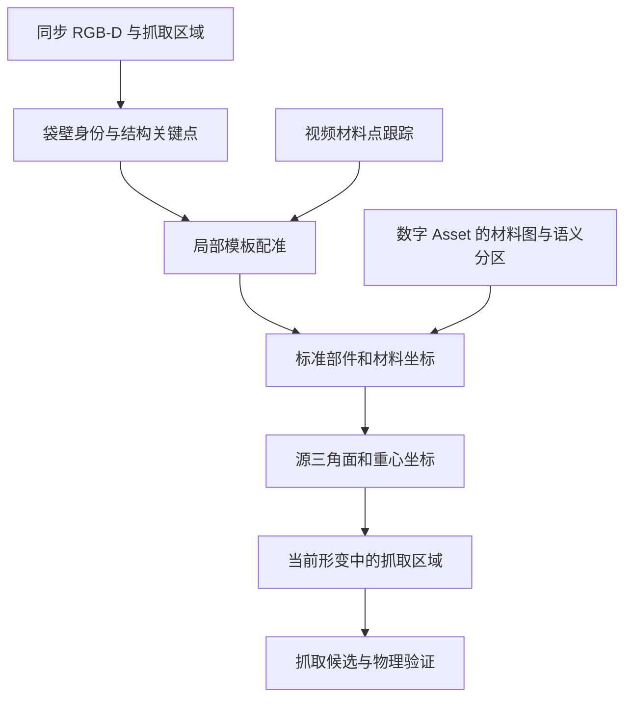

# 技术路线：从视频抓取区域到资产材料位置

## 1. 任务定义

已知视频帧 `I_t`、可用深度 `D_t`、内参 `K`、相机坐标约定和袋子模板 `M=(V,F)`。查询可以是像素点、边缘材料带或抓取区域。输出模板上的一个或多个材料锚点，以及部件、材料侧、可见性和置信度。

同实例目标是同一物理材料的对应；跨实例目标是预先定义的结构／功能对应。拓扑相同不唯一确定逐点映射：对称袋壁、把手方向、边界起点和局部尺度都需要额外锚点或观测。

当前主要研究袋口和把手附近的局部表面。局部结果可供抓取初始化；完整袋子状态估计和碰撞模型覆盖需要单独验证。

## 2. 总体流程

主线先实现 B1 的可解释坐标与 B2 的几何配准，视频跟踪提供时序约束。后续学习模型替代人工结构定位或初始化，保留同一输出合同。

## 3. 三层表示

### 结构层

以实际存在的部件为节点：袋壁、袋口材料带、把手桥、把手连接区域、侧缝、袋底。边表示材料连接或部件隶属；袋口和把手孔作为可审核的边界结构。

`part_id` 区分前后袋壁；`surface_side` 区分同一片材料的内外侧。这是两个变量。前后命名绑定资产参考姿态和已选可见壁，不随相机转动重新命名。

每种袋子的结构可能不同。跨实例只映射可比较子结构；没有把手的袋子不能硬分配一个把手对应。

### 材料坐标层

为审核过的局部片区建立图册 `(chart_id,u,v)`。袋口边带可取：

- `u`：从指定侧缝／材料锚点出发，沿指定方向的参考材料边界归一化弧长。
- `v`：从边界向袋身内部的局部材料坐标；必须记录坐标构造、单位或归一化宽度。

闭合环需要切口和方向；分叉边界需要先选定局部链。全袋用多片图册并记录接缝，避免把前后两层压成同一套坐标。跨袋 `u/v` 的归一化是功能映射约定，不声称是天然物理材料身份。

### 网格锚点层

保存 `source_mesh_sha256 + face_id + barycentric`。原始 OBJ 采用零基顶点／面索引，初始化不焊接、不重排面。

若面顶点为 `i,j,k`，锚点为：

\[
p_t=b_1V_i(t)+b_2V_j(t)+b_3V_k(t),\qquad b_r\geq0,\quad\sum_r b_r=1.
\]

抓取区域由同片材料上的若干锚点或一组源面组成，另存材料侧、面积／测地半径和接近方向。抓持无滑移时身份固定；滑移后根据证据更新。法向和切向由当前局部材料面计算，不能只把原始法向整体旋转。

## 4. 输入几何与坐标合同

1. **帧索引**：读取 `frame_map.json`，使用 `active_index` 作为本项目主索引。原始视频547帧、预裁剪采样137帧、有效103帧；历史用户抽帧35帧不是另一段独立采集。
2. **分辨率**：原生 RGB／深度1280×720；旧处理 RGB／掩码518×294。历史像素提示使用原生分辨率。缩放内参时分别乘宽高比例。
3. **深度**：使用原始 `native_depth_frames` 中非零 uint16 值乘0.001米。旧 `depth_frames` 含有效深度填充策略，不用于生成直接深度真值。
4. **畸变**：上游记录 `color_distortion_rectified=false`。示例点云在注册彩色网格上用 `cv2.undistortPoints` 求射线，再乘原生深度；没有先重映射图像再重复去畸变。
5. **深度语义假设**：暂按注册深度为彩色相机光轴方向的 Z 值处理。相机原始注册与标定精度需用物理测量／平面检查确认；代码投影回环通过只能检查实现自洽。
6. **世界坐标**：示例继承上游桌面估计的相机到世界变换。它不是已完成的机器人手眼标定；首轮对应可留在相机坐标中求解。
7. **遮挡**：缺手掩码不自动变成“无手”，零深度不自动补成测量值。现有袋口轨迹、手模型和交互候选都是观测先验，不是真实接触真值。

## 5. 路线 A：语义局部材料坐标

适合少量视频、可辨认袋口／把手，以及需要先得到可审核结果的阶段。

1. 为 Asset 标注局部材料链和部件；在视频上确定同名结构锚点。
2. 只在同一部件内拟合局部坐标。轻微形变、近似单层时可先做分片仿射／薄板样条初始化；点布局必须约束目标区域，不能任意外推。
3. 利用深度恢复可见边界的三维几何，结合参考材料链确定位置。单幅图像的横坐标比例不等于材料弧长，当前三维弧长在材料拉伸时也不等于参考弧长。
4. 在对应图册中查询资产源面，返回面号、重心坐标与区域范围。

先保留多个袋壁／方向候选，在关键点、材料侧与几何支持不足时拒答。该路线依赖人工结构标注，但无需学习检查点。

## 6. 路线 B：关键点约束的非刚性模板配准

适合同实例 bag2、有原生深度的当前起点。配准的方向为“将固定材料身份的资产模板变形到视频观测”，从而使观测位置可以回查模板材料 ID。

### 初始化

先按结构关键点求粗刚体变换；测量资产默认不自由拟合全局尺度。选定正确袋壁和局部材料片区，再匹配可见袋子点云。至少需要空间分布合理的对应点；整条直袋缘上的共线点无法稳定约束全部姿态。

### 优化

以模板顶点或材料连通的变形图为变量，可采用：

\[
E=\lambda_dE_{\mathrm{visible\ depth}}
+\lambda_kE_{\mathrm{landmark}}
+\lambda_sE_{\mathrm{silhouette}}
+\lambda_rE_{\mathrm{material\ regularity}}
+\lambda_tE_{\mathrm{temporal}}.
\]

可见数据项使用鲁棒距离、深度遮挡判断与法向一致性；遮挡和背面顶点由先验约束，不能全部拉到当前可见点云。材料正则约束边长、邻接和合理局部形变，禁止用空间 kNN 将贴近的前后袋壁连接起来。折叠／拉伸能力与正则强度需要通过真实片区检查调整。

[Trimesh NRICP](https://github.com/mikedh/trimesh/blob/main/docs/content/nricp.md) 提供带关键点约束的实现入口。原算法不自动处理本项目的袋壁语义、可见性和接触；需要明确实现这些约束并评估适用范围。[Neural Non-Rigid Tracking](https://github.com/DeformableFriends/NeuralTracking) 可参考学习对应置信度与变形图优化，其公开系统处理 RGB-D 非刚性跟踪。

### 回查与连续更新

在已变形模板的**限定部件**内投影查询点，取三角面和重心坐标，再用相同面／重心坐标回到参考 Asset。最近邻只在初始化与已限定片区中使用，不在每帧无约束更换材料身份。自交、折叠翻面或可见性冲突时保留歧义。

## 7. 路线 C：时序跟踪

[CoTracker3](https://github.com/facebookresearch/co-tracker) 跟踪视频二维点；[SpaTrackerV2](https://github.com/henry123-boy/SpaTrackerV2) 提供三维点跟踪路径。它们提供的是视频内部的点轨迹，初始视频点与 Asset 材料位置的对应仍由 A/B 或人工锚点建立。

跟踪对象选择材料上的稳定特征、缝线或可辨认边界邻域。轮廓极值点、手指位置和受遮挡切换的外轮廓未必始终是同一材料点。无纹理袋子需要更依赖结构、深度和不确定度。

可见段将点轨迹作为非刚性优化约束；遮挡段保存预测和可见性，重现时重新核验部件和材料邻域。要同时报告视频点跟踪误差与 Asset 材料对应误差。

## 8. 路线 D：跨实例学习

[UniGarmentManip](https://github.com/luhr2003/UniGarmentManip) 学习同类别、不同形变衣物的结构与功能对应；[DexGarmentLab GAM](https://github.com/wayrise/DexGarmentLab/blob/main/GAM_Usage.md) 将示范点迁移到目标衣物点云。这是后续跨袋迁移的主要参考，现有衣物权重不视为袋子模型。

准备每个资产的部件图和图册，仿真中固定材料 ID，随机化形变、视角、光照、纹理和遮挡。渲染每个可见像素的源面、重心坐标、部件和表面侧标签；跨资产监督来自审核过的标准坐标，不来自“原始顶点序号相同”。

可先训练两种输出之一：

- 部件分类＋局部材料坐标＋可见性／置信度。
- 稠密描述子：将相应材料／功能区域拉近，再在目标 Asset 中检索候选。

先使用不依赖外观的材料标签和几何基线验证数据生成，再加入真实少量标注调整域差异。只有局部抓取对应不足以支撑任务时，再考虑 GarmentNets／GarmentTracking 式完整形状与标准空间估计。

## 9. 当前资产的具体问题

本轮检查保留了原始面号：bag1 为917顶点／1708面，bag2 为601／1057，bag3 为485／936。旧文档中 bag3 的481顶点来自清理后的表示，不能与原始索引混用。

bag1 有三个简单边界候选；bag3 有一个简单候选。bag2 有一个连通边界候选，但边界顶点299、440、514、515、526、527存在分叉，未构成单一简单环。没有非流形边不代表所有顶点邻域都是流形。

因此，不能对 bag2 直接套“检测到三个环，所以分别是袋口和两个把手孔”的规则。优先人工确认局部袋口材料链；如需修复，在派生副本中显式记录源顶点／源面映射，并更新网格指纹。源资产保持不变。

## 10. 与原工程对接

原工程的 `upstream.py` 提供整体坐标与人手附近袋缘初始化，`task.py` 和接触模块已有面／重心坐标的材料锚点。新模块将返回同类锚点，但携带明确材料身份、区域、侧和置信度。

接入前必须建立“本探索原始 OBJ 面号 → 现有清理网格 → MuJoCo flex”的显式转换。机器人组合模型可能改变全局数组偏移，不能直接使用源顶点序号索引 `flexvert_xpos`。几何上落到正确区域后，仍需抓取可达性、接近方向、指腹空间、正确层数和物理保持检查。

## 11. 输出合同

未来输出满足 `../schemas/correspondences.schema.json`，每个查询允许多个候选或拒答。完整材料锚点满足 `anchor.schema.json`，另在代码中检查重心坐标和为1、面号范围与网格指纹。示例准备阶段尚未生成任何对应预测。
